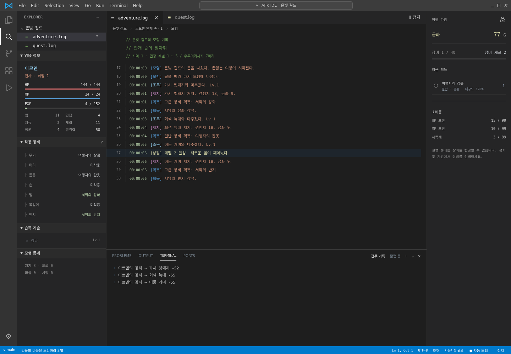
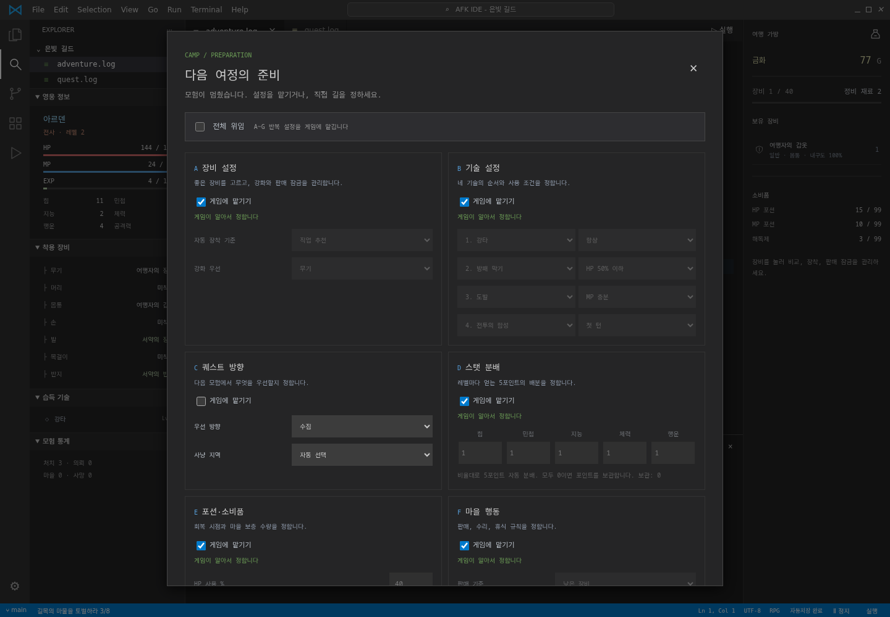
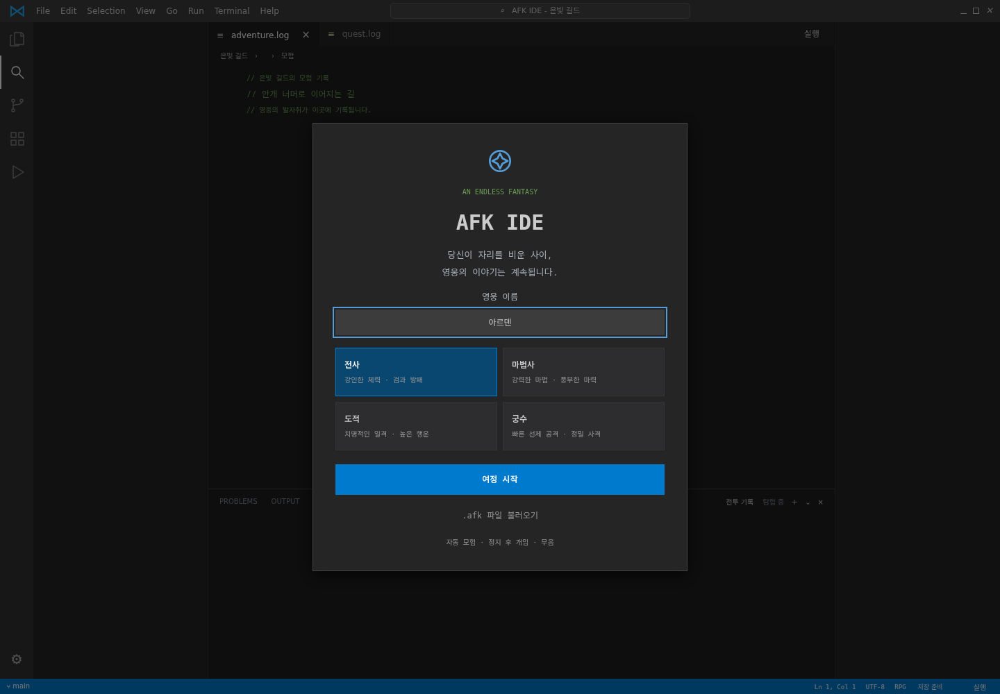
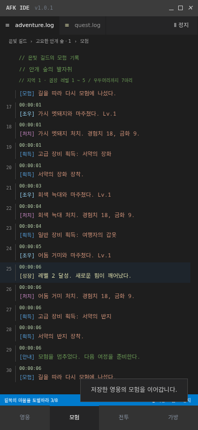
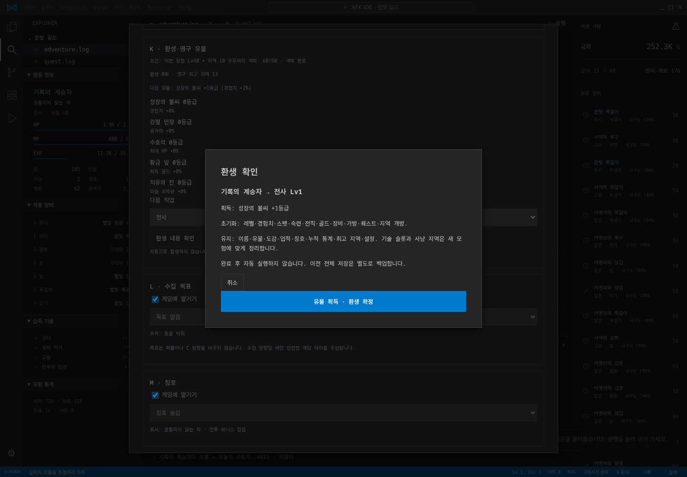
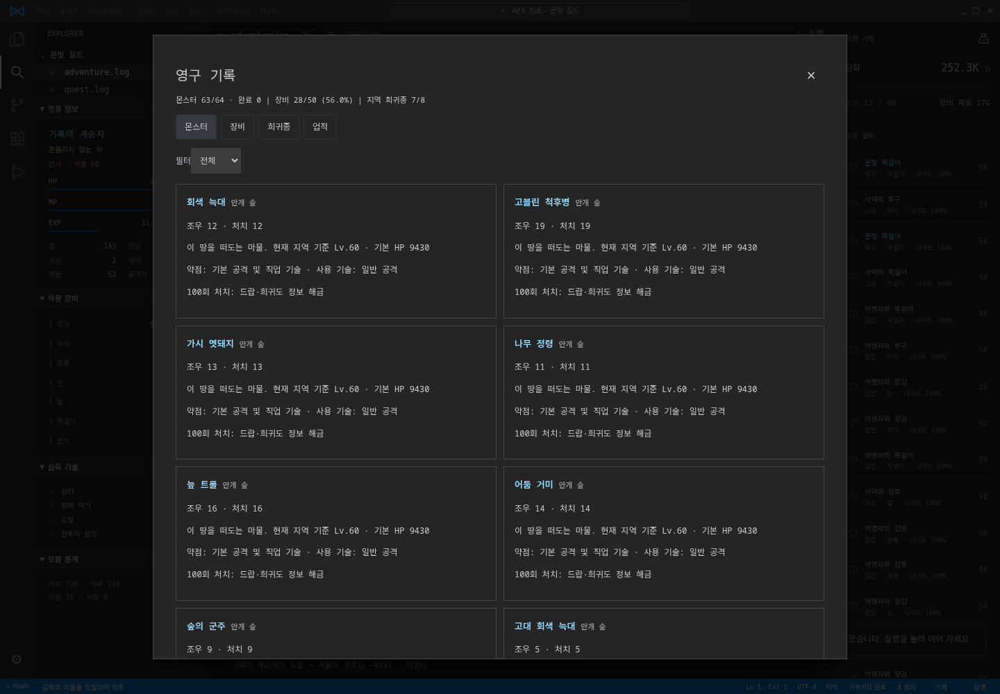
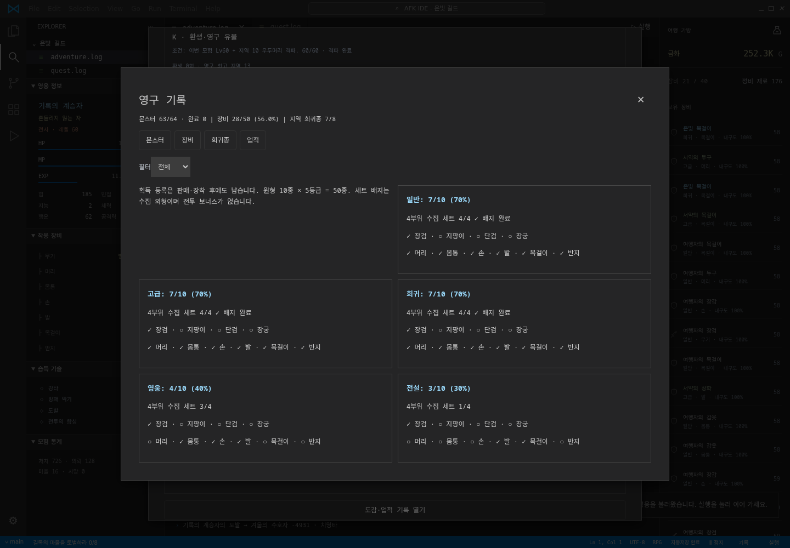
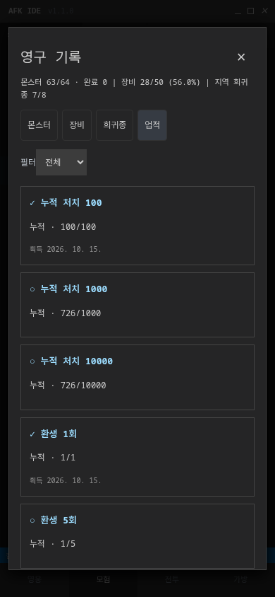

# AFK IDE

### 자리를 비운 동안에도, 영웅의 여정은 계속됩니다.

VSCode 같은 어두운 IDE 화면 속에서 펼쳐지는 **정통 판타지 방치형 RPG**입니다. 화면은 개발 도구처럼 보이지만, 안에 담긴 것은 몬스터, 장비, 기술, 퀘스트입니다. 실행하면 영웅이 스스로 모험하고, 정지하면 다음 여정을 준비할 수 있습니다.

## v1.0.3 다중 턴 전투·자동 진행 수정

VSCode Dark+ 팔레트, 탐색기 트리, activity bar, `adventure.log` / `quest.log` 탭, 모노스페이스 로그, 통합 터미널과 파란 상태바로 UI를 개정했습니다. 게임 용어와 저장 호환성은 그대로 유지합니다.

v1.0.2에서는 상단 장식 메뉴를 비활성 색상으로 구분했고, HP/MP/EXP를 VSCode의 2px 파란 determinate progress 형태로 통일했습니다. 전투 턴은 0.8초에서 3.2초, 탐험은 1.2초에서 4.8초, 귀환은 4.8초, 마을 휴식은 6초로 늘렸습니다. 피해량·경험치·전리품 확률은 바꾸지 않아 기존 캐릭터의 수치 밸런스를 유지하면서 실제 진행만 느긋해졌습니다.

## 플레이

[지금 플레이하기](https://sigco3111.github.io/afk-ide/) · [전체 설계 문서](docs/DESIGN.md) 설치나 계정, 서버가 필요 없습니다. 사운드는 없습니다.

1. 영웅의 이름과 기본 직업을 고르고 **여정 시작**을 누릅니다.
2. 사냥 → 전리품 → 의뢰 완료 → 마을 귀환 → 판매·수리·회복·보급 → 재출발이 자동으로 반복됩니다.
3. **정지**를 누르면 현재 전투가 끝난 뒤 개입 화면이 열립니다.
4. 반복 설정은 기본적으로 모두 게임에 위임되어 있습니다. 직접 관리하고 싶은 메뉴만 위임을 해제하세요.
5. 레벨 30 이후 시련에서 5회 처치하면 정지 화면에서 1차 전직을 선택할 수 있습니다.
6. 브라우저에 자동저장됩니다. 기기를 바꾸거나 데이터를 보관하려면 **캐릭터 내보내기**로 `.afk` 파일을 보관하세요.

> 창이 열려 있는 동안만 진행합니다. 창을 닫은 시간의 오프라인 보상은 없습니다. 백그라운드 탭은 브라우저 정책에 따라 느려질 수 있으며, 돌아오면 열려 있던 시간 범위 안에서 경과 시간을 보정합니다.

## 화면

| 자동 모험 | 정지 후 개입 |
|---|---|
|  |  |

| 시작 화면 | 모바일 모험 |
|---|---|
|  |  |

데스크톱은 영웅 정보, 모험 일지, 전투 기록, 가방, 하단 상태바의 다섯 영역으로 구성됩니다. 휴대폰에서는 **영웅 / 모험 / 전투 / 가방** 탭을 사용합니다. 아이콘은 모두 SVG이며, 외부 이미지나 음원을 내려받지 않습니다.

## v1의 핵심 시스템

### 네 직업과 1차 전직

| 기본 직업 | 1차 전직 | 특징 |
|---|---|---|
| 전사 | 나이트 | 힘과 체력, 높은 생존력 |
| 마법사 | 위저드 | 지능과 마력, 강한 기술 피해 |
| 도적 | 로그 | 민첩과 행운, 치명타·보물·함정 대응 |
| 궁수 | 레인저 | 민첩과 힘, 첫 턴 선제 공격 |

기본 기술은 레벨 1 / 5 / 10 / 20에 해금됩니다. 1차 전직에서 세 기술을 더 얻습니다. 기술은 MP와 재사용 대기 턴을 사용하며, 사용 횟수에 따라 최대 Lv10까지 숙련도가 오릅니다. 네 슬롯의 조건과 순서에 따라 자동으로 기술을 선택합니다.

### 끝없는 모험

- 시드와 지역 번호로 같은 지형을 재현합니다. 숲, 늪, 사막, 설산, 동굴, 폐허, 화산, 심연의 여덟 테마가 이어집니다.
- 테마마다 일반 몬스터 6종과 우두머리 1종이 있습니다. 일반 처치를 쌓으면 우두머리를 만나고 다음 지역이 열립니다.
- 지역 번호가 커질수록 적이 강해집니다. 현재 영웅 레벨과 위험 허용도를 반영해 적 레벨을 조정합니다.
- 토벌, 수집, 탐험, 우두머리 의뢰를 자동 수락하고, 완료 즉시 보상과 다음 의뢰를 받습니다.
- 조우에는 보물상자 4%, 함정 3%, 떠돌이 상인 3%, 희귀 몬스터 2%가 포함됩니다.
- 사망하면 금화 10%를 잃고 부활합니다. 게임 오버나 엔딩은 없습니다.

### 장비와 마을

무기, 머리, 몸통, 손, 발, 목걸이, 반지의 7슬롯. 일반 / 고급 / 희귀 / 영웅 / 전설의 5등급입니다. 장비는 레벨별 위력, 추가 스탯, 내구도와 +10까지의 강화를 가집니다. 강화 실패에도 파괴되지 않습니다. 가방은 장비 40칸이고 소비품은 별도 최대 99개씩 보관합니다.

가방이 90% 이상 차거나 회복 보급이 부족하면 마을로 돌아갑니다. 규칙에 따라 잠기지 않은 장비를 판매하고, 내구도 30% 미만 장비를 수리하고, 휴식·포션 보충·강화를 한 뒤 다시 출발합니다. 잠근 아이템은 자동 판매에서 제외됩니다.

### 정지 후 개입 A~H

| 메뉴 | 직접 정하는 것 |
|---|---|
| A 장비 | 자동 장착 점수 기준, 강화 우선 부위. 가방에서 비교·교체·판매 잠금 |
| B 기술 | 네 슬롯과 항상 / HP 50% 이하 / MP 충분 / 우두머리 / 첫 턴 조건 |
| C 퀘스트 방향 | 사냥 / 퀘스트 / 수집 / 안전, 열린 지역 중 사냥터 선택 |
| D 스탯 | 다섯 능력치 배분 비율, 미분배 포인트 수동 사용 |
| E 소비품 | HP·MP 사용 임계값, 마을 목표 수량, 해독제 규칙 |
| F 마을 | 판매 기준, 수리 여부, 휴식 수준 |
| G 위험 | 1 신중 ~ 5 과감 |
| H 전직 | Lv30 시련 완료 후 1차 전직 직접 선택 |

A~G 위임 체크박스는 독립적이며 기본 켜짐입니다. 위임은 수동 설정을 덮어쓰지 않고 별도의 직업·상황 추천값을 사용합니다. 다시 해제하면 직전 수동값이 복원됩니다. 전직은 전체 위임 대상이 아닙니다.

## 저장과 보안

- **자동저장**: 30초마다, 전투 종료·마을 귀환·정지 등 주요 상태 변경 시 암호화해 `localStorage`에 저장합니다. 슬롯은 하나입니다.
- **내보내기**: 영웅 이름의 `.afk` 파일을 내려받습니다. 정지 상태에서 이용합니다.
- **불러오기**: 파일 크기·헤더·인증·스키마를 검사한 뒤 대체 확인을 받습니다. 취소하면 현재 영웅은 유지됩니다. 불러온 영웅은 정지 상태로 시작합니다.
- **AES-256-GCM**: 매 저장마다 16바이트 무작위 솔트와 12바이트 IV를 새로 만듭니다.
- **키 파생**: PBKDF2 / SHA-256 / 100,000회. AES 키와 HMAC 키는 파생 비트에서 분리합니다.
- **이중 무결성**: 정렬된 JSON 전체의 HMAC-SHA-256과 GCM 인증 태그를 검사합니다.
- **파일 레이아웃**: `AFK1 | 버전 1바이트 | 솔트 16바이트 | IV 12바이트 | 암호문+태그`, 전체 Base64.
- **범위 검사**: 경험치 누적과 현재 레벨의 일치, 스탯·장비·포션·설정·로그의 형식과 범위를 검사합니다.

> 서버 없는 클라이언트 게임입니다. 빌드 안의 키 재료는 코드를 분석하는 사람에게 숨길 수 없습니다. 일반적인 텍스트 편집과 파일 손상은 탐지하지만, 전문적인 조작을 완벽하게 막는 서버 검증은 아닙니다. 브라우저 데이터 삭제·비공개 모드·저장 공간 부족에는 자동저장이 사라질 수 있으므로 중요한 영웅은 파일로 보관하세요.

## 기술 구조

외부 런타임 의존성이 없는 HTML / CSS / ES modules로 구성됩니다. GitHub Pages에는 동일 소스를 합친 `index.html`을 배포하며, 네트워크 없이도 화면·게임·암호화가 돌아갑니다. Web Crypto를 위해 HTTPS 또는 localhost 환경이 필요합니다.

| 파일 | 역할 |
|---|---|
| `data.js` | 직업·지역·아이템 등급·기본 설정 데이터 |
| `engine.js` | 상태, 위임 조회, 전투·성장·전리품·의뢰·마을·지역 생성 |
| `save.js` | 암호화·복호화·무결성·스키마 검사·저장 큐 |
| `ui.js` | 화면, 로그, 개입 메뉴, 파일 입출력, 200ms 루프 |
| `style.css` | IDE 레이아웃, 320px / 390px 모바일 대응, 접근성 |
| `index.html` | 배포용 단일 파일 |
| `source.html` | 모듈을 불러오는 개발용 HTML |
| `build.py` | 모듈 소스에서 배포용 HTML 생성 |
| `docs/DESIGN.md` | 승인된 전체 한국어 설계 문서와 로드맵 |
| `tests/engine.test.js` | 4직업 성장·전직·루프·저장·변조·정지 테스트 |
| `tests/browser.test.js` | 실제 Chrome UI·모바일·저장·위임 테스트 |

전투는 고정 틱 상태 기계로 진행합니다. 렌더링과 전투를 분리하고, 정지 요청은 현재 전투 결과를 확정한 뒤 반영합니다. 로그는 각각 최근 200줄로 제한합니다. 저장 큐는 한 번에 하나씩 암호화하여 오래된 비동기 저장이 새 진행을 덮는 문제를 막습니다. 사용자 이름과 불러온 문장은 HTML로 해석되지 않도록 이스케이프합니다.

### 개발 실행과 테스트

```sh
python3 -m http.server 8080
# 브라우저에서 http://localhost:8080/source.html
npm test
# UI 테스트: Chrome과 playwright 필요
npm install --no-save playwright
node tests/browser.test.js
# 배포용 HTML 재생성
python3 build.py
```

## 검증

- 4직업 × 3회 자동 테스트에서 모두 기본 위임 상태로 Lv30 도달, 시련 완료, 사망 0회.
- 1차 전직 뒤 추가 2,000회 틱을 진행해 Lv71~73 구간, 마을 판매·보급·재출발, 퀘스트와 네 랜덤 이벤트 확인.
- 암호화 저장 왕복 일치, 파일 한 글자 변조 거부, 전투 종료 후 정지, 정지 중 상태 불변 확인.
- 실제 Chrome에서 레벨업, 로그, 정지 화면, 7개 위임 기본값, 위임 해제 후 수동값 복원, 암호화 자동저장·새로고침 복원 확인.
- 320px / 390px 모바일의 네 탭과 설정 화면에서 가로 넘침 없음 확인.

수치와 확률은 첫 버전의 초기 밸런스입니다. 새 직업·새 기능은 기존 저장과의 호환성을 확인한 뒤 확장합니다.

## 이후 계획

- **v1.1**: 환생과 영구 유물, 몬스터 도감·장비 수집첩·희귀종 수집, 업적과 칭호, 2차 전직.
- **v1.2**: 무한의 탑, 탑 최고 기록·배지, 목표 자동 정지, 로그 필터.
- **v1.3**: 3차 전직, 전설 고유 효과와 장기 콘텐츠 확장.

이 기능들은 현재 v1에 구현된 기능이 아닙니다. 자세한 해금 조건, 보존·초기화 규칙, 인수 기준은 [설계 문서](docs/DESIGN.md)를 참고하세요.


UI 참고: [VSCode 공식 User Interface 문서](https://code.visualstudio.com/docs/getstarted/userinterface)의 workbench 구성을 기준으로 비교했습니다. AFK IDE는 Microsoft와 관계없는 독립 게임입니다. 상단 메뉴와 소스관리/확장 등의 일부 아이콘은 시각적 표현이며 실제 IDE 기능을 제공하지 않습니다.

VSCode 진행 표시 근거: [공식 progressbar.css](https://github.com/microsoft/vscode/blob/main/src/vs/base/browser/ui/progressbar/progressbar.css). VSCode에는 HP/MP 개념이 없으므로, 이 게이지는 VSCode의 determinate 진행 표시를 게임 자원에 적용한 표현입니다.

### v1.0.3

- 일반/희귀/우두머리 몬스터 HP를 기존 기준의 14배로 늘려 한 전투에서 여러 턴을 주고받도록 조정했습니다. 전투 화면에 현재 턴 수도 표시합니다.
- 턴 간격은 1.2초, 탐험 2.4초, 귀환 3.2초, 휴식 4초로 조정했습니다. v1.0.2의 3.2초 턴 대기를 줄이고 실제 전투의 턴 수를 늘리는 방향입니다.
- Lv30 시련 완료가 자동 정지/설정 팝업을 강제하던 원인을 수정했습니다. 이제 알림만 남기고 계속 모험합니다. 사용자가 정지해야 수동 전직을 선택합니다.
- 전투 중 사용자가 정지를 요청했을 때 전투 종료 후 설정 화면이 열리는 동작은 유지합니다.
- 이미 진행 중인 전투의 HP는 세이브를 그대로 보존하며, 다음 조우부터 새 HP가 적용됩니다.

## v1.1.0 환생·도감·업적

- K 환생: 이번 모험 Lv60 + 지역 10 우두머리 격파. 다음 직업과 초기화/유지 목록을 보고 별도 확정합니다. 자동 환생하지 않고 완료 후 정지 상태로 남습니다.
- 유물은 1회 1개 확정. 성장의 불씨 → 강철 인장 → 수호석 → 황금 잎 → 치유의 잔 순서로 반복하며 중복은 등급이 됩니다. 경험치/공격력/HP/골드/마을 회복에 등급당 2% 적용합니다.
- 모험 레벨·장비·골드·스킬·지역은 초기화하고 유물·도감·업적·칭호·누적 통계·최고 지역은 유지합니다. A~G와 L/M 설정을 보존하되 기술 슬롯/지역은 새 모험에 맞게 정리합니다.
- 몬스터 고정 원형 64종: 일반48 + 우두머리8 + 대표 희귀종8. 첫 조우, 1/10/100 처치마다 정보가 해금됩니다. 지역 번호가 늘어나도 같은 원형에 누적합니다.
- 장비 수집첩 50종: 무기4종+방어구6종 × 5등급. 획득 시 등록, 중복/판매로 수집률이 바뀌지 않습니다. 등급별 4부위 수집 세트 배지는 외형 보상입니다.
- 8개 테마 대표 희귀종은 기존 2% 조우를 유지합니다. 각 테마의 대표종 풀은 현재 1종입니다. 위험 회피가 수집보다 우선하며 목표를 골라도 확률은 오르지 않습니다.
- 업적 11종: 처치100/1000/10000, 환생1/5/10, 희귀종1/4/8, 사망 없이 지역10 우두머리, 네 직업 1차 전직. 즉시 한 번만 지급하고 완료/미완료 필터를 제공합니다.
- 외형 칭호: 돌아온 자 / 경계를 살핀 자 / 흔들리지 않는 자 / 네 길의 계승자. M 위임 시 최근 획득 칭호, 해제 시 마지막 수동 선택(숨김 포함)을 복원합니다.
- L 수집 목표는 몬스터/희귀종/장비 중 하나를 추적합니다. 자동 추천은 현재 안전 테마 우선. C 방향은 바꾸지 않으며 C가 수집일 때만 열린 안전 지역을 우선합니다.
- 하단 **기록**은 실행 중에도 읽을 수 있습니다. K/L/M 변경은 정지 후 설정에서 합니다. 자동 진행 중 전직/환생 조건 달성이 팝업을 강제하지 않습니다.

### 저장 호환과 안전

모험 필드와 `permanent` 영구 기록을 분리했습니다. v1 저장도 그대로 복호화하고 순차 이관합니다. 과거 처치/획득 이력은 추정하지 않으며 현재 보유 장비만 등록합니다. 이관 원본은 브라우저에 백업합니다. 환생은 전체 이전 저장을 백업하고 새 저장 성공 후에만 화면 상태를 바꿉니다. 저장 실패는 기존 모험을 유지합니다.

환생 기록도 AES-GCM/HMAC에 포함되며 처치 결과는 runId+전투 순번으로 중복 반영을 막습니다. 가져오기는 모험과 영구 기록을 통째로 교체하므로 오래된 파일은 도감/칭호도 되돌립니다. 브라우저 삭제를 막는 서버 백업은 아닙니다.

검증: `node tests/progression.test.js`, `node tests/records-ui.test.js`, `node tests/balance.test.js`, 기존 engine/browser/multiturn 회귀 테스트. 실제 배포 테스트는 `AFK_URL=https://sigco3111.github.io/afk-ide/ node tests/records-ui.test.js`.

무한의 탑과 2차 전직/새 테마·새 기술은 이번 핵심 v1.1 릴리스에 포함하지 않았습니다. 탑은 v1.2 계획이며 그 외 확장도 후속 범위입니다.

### v1.1 실제 배포 화면

| 환생 확인 | 몬스터 도감 |
|---|---|
|  |  |

| 장비 수집첩 | 모바일 업적 |
|---|---|
|  |  |

동일 시드 단일 엔진 측정(초, 전사/사망0): 환생 0/5/10회에서 Lv10 650/665/581, 지역10 도달 3908/3731/3740, 환생 가능 5309/5023/5206. 각 5회마다 모든 유물 1등급씩 보유한 조건입니다. 보상 보정은 적용되나 난수·장비 경로로 모든 구간이 단조롭게 빨라지지는 않습니다. 이 수치는 실기기 로딩 시간이 아닌 게임 시뮬레이션 경과 시간이며, 통계적 평균이나 속도 보장이 아닙니다.

## v1.2.0 무한의 탑

N 메뉴는 정지 상태의 Lv30 영웅에게 열립니다. 무료/일일 제한 없이 지역 모험 대신 탑 전투를 시작하며, 같은 모험에서는 마지막 완료 층의 다음 층부터 이어집니다. 10층마다 우두머리, 층별 능력은 기본값 × 1.12^(층−1), 우두머리는 추가 ×1.5입니다. 초기 기준 HP650/공격34/방어18입니다.

패배는 골드 손실 없이 회복하고 기본 정지합니다. N에서 자동 재도전을 직접 켠 경우만 계속하며 연속3패면 지역으로 돌아갑니다. 전체 위임은 이 옵션을 켜지 않습니다. 전투 도중 정지는 해당 층 전투가 끝난 뒤 반영합니다. 층 사이에는 기존 소비품 임계/목표 수량과 골드로 포션 보충·장비 수리, 휴식 설정에 따른 유료 회복(레벨×0.5 올림 골드)을 합니다. 회복 자원이 없고 안전 임계 아래면 정지 안내합니다.

완료 층만 최고 기록에 반영합니다. 지역 개방/퀘스트/지역 도감은 탑에서 진행하지 않습니다. 경험치·골드·장비는 적 공격력에 대응하는 지역 레벨 보상을 기준으로 계산합니다. 이미 완료한 층을 골라 반복할 수 없습니다. 10층 단위 최초 배지와 10/50/100층 업적을 자동 등록하고 100층 칭호는 심연을 걷는 자입니다. 환생 때 이번 모험 층은 0, 영구 최고/배지/업적은 유지합니다.

층수와 큰 능력의 지수는 정수 문자열로 저장하고 HP는 남은 비율로 계산합니다. 10^39층 계산에서도 Infinity/NaN 없이 지수 표기하고 저장 검사를 통과합니다. 표시 가수는 부동소수 근사치이지만 층 번호와 최고/배지 ID는 정수 정밀도를 보존합니다. 기존 v1/v1.1 저장은 탑 기록0으로 이관합니다.

I 목표 자동 정지: 레벨/열린 지역/장비 수집 수, 사용자가 직접 켠 목표만 전투 사이에 멈춥니다. J 모험 로그 필터: 전체/처치/획득/성장·업적/위험/안내. 필터는 기록을 삭제하지 않습니다.

검증: `node tests/tower.test.js`, `node tests/tower-ui.test.js`. 라이브 UI 검증은 `AFK_URL=https://sigco3111.github.io/afk-ide/ node tests/tower-ui.test.js`.

### v1.2.1 탑 바로가기
데스크톱 왼쪽 activity bar의 탑 아이콘, 모바일 하단의 '탑'에서 바로 엽니다. Lv30 미만은 해금 안내만 표시하고 자동 모험을 멈추지 않습니다. 모험 중에는 '현재 모험 정지 · 탑 준비'를 선택해야 정지하며, 전투 중이면 현재 전투가 끝난 뒤 입장 창을 엽니다. 정지 상태에서는 다음 층 입장 또는 N 상세 설정을 바로 선택할 수 있습니다. 바로가기 창을 여는 것만으로 모험을 멈추거나 탑에 자동 입장하지 않습니다.

### v1.2.2 네 개의 새 땅

|지역(새 모험)|테마/분위기|권장 레벨|우두머리|대표 희귀종|
|---|---|---|---|---|
|9|달빛 성역: 월식에 물든 성소|41~45|월식의 대사제|월백의 유니콘|
|10|가라앉은 왕국: 침수된 고대 궁전|46~50|해저의 왕관지기|청금의 바다뱀|
|11|폭풍 고원: 비룡과 번개의 절벽|51~55|천둥의 비룡왕|백뢰의 그리핀|
|12|맹세의 묘지: 망국 기사들의 묘역|56~60|망국의 서약기사|검은 장미의 망령|

각 테마 일반6종+우두머리1종+희귀종1종, 총32종 추가. 전체 몬스터 도감64→96종, 지역 대표 희귀종8→12종. 기존1/4/8종 업적과 칭호 조건은 변경하지 않습니다. 희귀종2%와 위험 회피 규칙, 일반10마리 후 우두머리/격파 후 다음 지역 개방, 전투력·경험치·보상 곡선은 기존과 같습니다. 특수 신규 전투 패턴은 없으며 이름/분위기/도감 수집량을 확장합니다.

기존1~8지역/도감ID는 그대로입니다. 새 모험은9~12에 새 테마,13~20에 기존8종,21~24에 새4종이 이어집니다. 과거 저장은 이미 열린 지역을 포함하는8지역 묶음 끝까지 기존 테마를 보존하고 다음4지역에 새 테마를 연결합니다. 예: 열린19지역이면24까지 보존,25~28 새테마. 이 경계는 암호화 저장하고 환생 후에는 새 모험 배치로 시작합니다. 환생해도 발견/처치/희귀종 기록, 탑 최고/배지는 보존합니다.

Lv60 전사/기본장비/1차전직, 위험3, 고정 난수 검증에서9~12지역 일반→우두머리→희귀종 각3전투를 사망 없이 통과. 일반HP는6280/7174/8120/9123, 공격66.2/74.3/82.8/91.5. 실제 적 레벨은 기존처럼 영웅레벨·위험도·해당지역 상한으로 정하며 별도 강제 레벨 잠금은 없습니다.

검증: `node tests/themes.test.js`, `node tests/themes-ui.test.js`. 후자에 `AFK_URL=https://sigco3111.github.io/afk-ide/`를 붙여 배포 검증합니다.

### v1.2.3 2차 전직

조건은 현재 모험1차 전직+Lv60, 그 이후 지역 마물10처치와 우두머리1처치입니다. 과거 처치를 추정해 채우지 않으며 탑 처치는 지역 시련에 포함하지 않습니다. 자격 달성은 상태바/퀘스트/로그로 알리되 자동 모험을 멈추지 않습니다. 정지 후 H에서 두 경로를 비교하고 확인창을 거쳐 선택합니다. 전체 위임으로 선택하지 않으며, 같은 모험에서 재선택할 수 없습니다. 환생하면 경로/시련/새 기술 숙련은 초기화합니다. 유물·도감·탑 영구 기록은 그대로입니다.

|기본→1차|2차 경로|공격/HP/방어 보정|새 기술3개|
|---|---|---|---|
|전사→나이트|팔라딘|+10/+15/+15%|심판의 빛 / 성역의 방패 / 축복의 기도|
|전사→나이트|버서커|+25/+5/+0%|광전사의 일격 / 불굴의 포효 / 피의 서약|
|마법사→위저드|아크메이지|+20/+5/+5%|별무리 폭발 / 원소의 장막 / 마력의 샘물|
|마법사→위저드|워록|+25/+10/+0%|심연의 불꽃 / 어둠의 결계 / 생명의 계약|
|도적→로그|어쌔신|+25/+5/+0%|처형의 칼날 / 연무의 장막 / 독의 비약|
|도적→로그|섀도우댄서|+15/+10/+15%|그림자 난무 / 환영의 춤 / 밤의 숨결|
|궁수→레인저|스나이퍼|+25/+5/+0%|관통의 화살 / 매의 경계 / 고요한 호흡|
|궁수→레인저|비스트마스터|+15/+15/+10%|야수의 돌진 / 곰의 수호 / 숲의 생명|

24기술의 이름은 경로별이고 현재 효과 유형은 공통3종입니다: 공격2.8배, 공격1.1배+해당 턴 받는피해75%감소, 공격1배+HP35%/MP20%회복. 비용10/11/12MP, 재사용3/4/2턴. 지역과 탑 모두 적용합니다. 전투 순서상 적이 먼저 행동했다면 이후 방어기술로 이미 받은 피해를 되돌리지 않습니다. 독립적인 소환수/지속독/다중타격 시스템은 아닙니다. B 위임은 새3기술과 기존 공격기술을 배치하고, 수동 B 값은 보존하며10개 중 고를 수 있습니다. 활성 슬롯은 기존4개를 유지합니다.

동일Lv60/기본장비 기준 전사 공격192.4→팔라딘211.6/버서커240.5, HP1064→1224/1117. 마법사185.8→223.0/232.3, 도적195.4→244.3/224.7, 궁수195.2→244.0/224.5. 전직 보정만 비교한 값이며 이후 드랍/강화에 따라 달라집니다.

저장 포맷 v3에 선택경로·시련·10기술 숙련/재사용을 추가합니다. 기존 파일은2차 미선택/시련0으로 초기화하고 기존7기술 숙련은 보존합니다. 검증은 `node tests/second.test.js`, `node tests/second-ui.test.js`.

### v1.2.4 기술64종·상태효과·연계

신규64종 = 기본직업별8종×4 + 2차경로별4종×8. 기존52개 기술명까지 총116개 기술명이며 한 경로에서22개 중 해금한 기술을4슬롯에 배치합니다. 기본직업 추가분은 Lv5/10/20/25/30/40/50/60, 뒤4개는1차 전직 필요. 경로 추가분은2차 전직 Lv60/60/65/70에 해금합니다. 일반/고급/희귀/영웅/전설은 기술 분류와 해금 단계이며 가챠나 별도 기술서 비용은 없습니다. 등급이 높아도 낮은 등급의 표식·방어와 연계할 수 있습니다.

B의 '기술 도감 · 효과와 연계'에서22기술의 이름/등급/해금조건/MP/재사용/효과를 봅니다. 위임 해제 후 순서와 조건을 고르며 잠긴 기술은 선택할 수 없습니다. 위임은2차에서 경로 표식(또는 약화)→경로 공격→방어/회복 조건을 사용합니다. 수동설정은 덮어쓰지 않습니다.

기본공격 외 효과11종: 강공격, 표식(받는피해+20%), 공격력25% 지속피해3턴, 공격+20% 버프, 받는피해-40% 버프, 방어70%관통,0.7배×3연타,1.2배 공격+25%흡혈(최대HP15%),HP25%/MP10%회복 공격, 적공격-25%, 체력30%이하 마무리2.7배(평소1.8배). 상태는 중첩 증폭하지 않고 해당 지속시간을 갱신합니다. 버프/약화/표식은 시전 턴 포함3턴, 도트는 다음3턴. 연타는 로그에3연타/합산피해로 표시하고 각각 방어를 적용합니다. 전투 시작 때 상태와 연계가 초기화됩니다. 기본공격은 상태효과 없이 순서를 끊습니다.

순서 연계4종: 표식→공격·관통·연타·마무리 '표식 격파', 지속피해→공격·관통·마무리 '상처 추격', 방어→공격·관통·연타·마무리 '수호 반격', 공격강화→연타 '집중 난무'. 직전 사용 기술에 따라 다음 기술피해+25%, 로그에 발동명을 표시합니다. 표식20%와 연계25%는 곱연산으로 일반 대비1.5배입니다. Lv70 기본장비 전사 고정 난수/방어100 표적: 관통362.344→표식+연계543.516. 숙련은30회마다+1.5%, 최대+15%.

기존2차3기술도 경로별 효과로 분리합니다. 팔라딘 관통/방어/회복, 버서커 연타/공격강화/흡혈, 아크메이지 연타/방어/공격강화, 워록 도트/약화/흡혈, 어쌔신 관통/도트/흡혈, 섀도우댄서 연타/방어/회복, 스나이퍼 관통/표식/공격강화, 비스트마스터 연타/방어/회복. 독립 소환수 AI가 아닌 야수 이름의 기술입니다. 기존 v1.2.3의 공통3효과 수치는 이 버전에서 교체합니다.

지역/탑이 같은 효과 함수를 사용합니다. 적 선공이면 시전 전 피해를 방어버프로 되돌리지 않습니다. 기존7/10개 숙련/재사용 인덱스는 유지하고22개로0확장합니다. 전투 상태·연계도 암호화 저장하며 새 전투/환생에 초기화합니다. 환생은 신규 수동 슬롯을0번으로 되돌려 미해금 기술을 쓰지 않게 합니다. 오프라인 진행/과금은 없습니다.

검증 `node tests/skills.test.js` (8경로×22개 효과,64추가/연계/도트/회복/흡혈/관통/저장·이관·탑), `node tests/skills-ui.test.js` (실전연계·지속피해,22개 선택/도감,320/390px).
