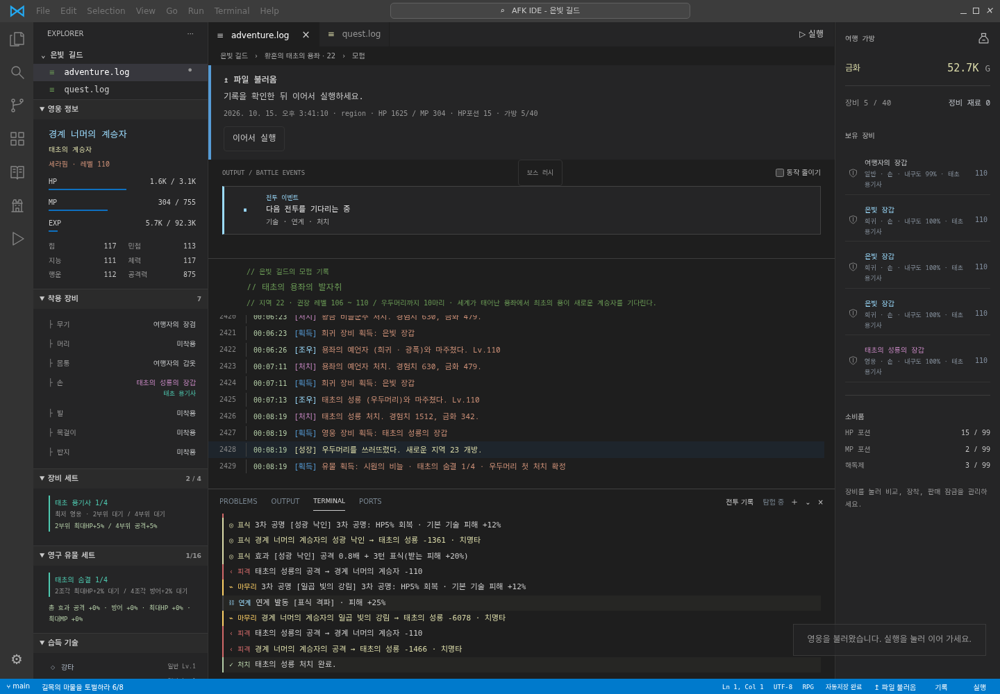
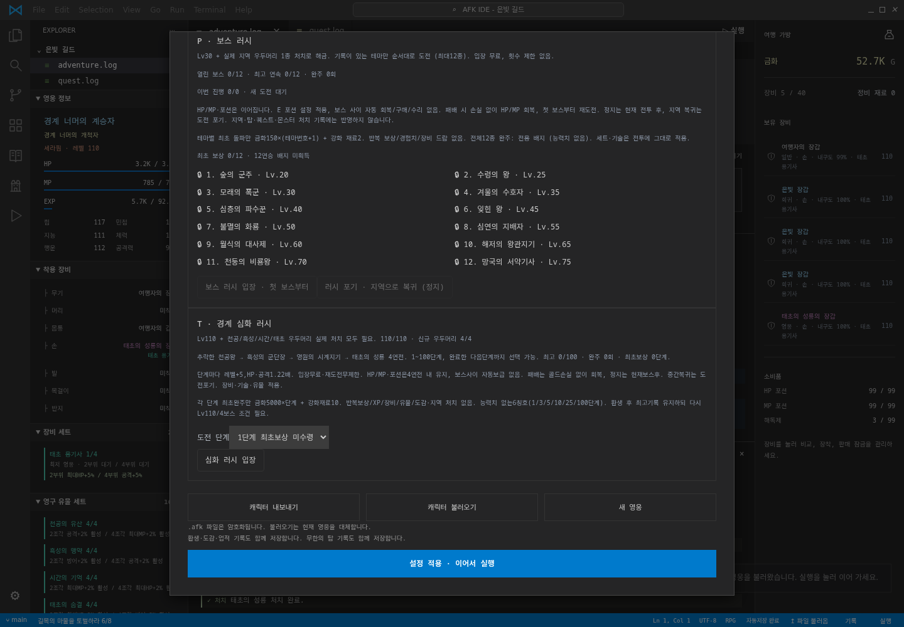
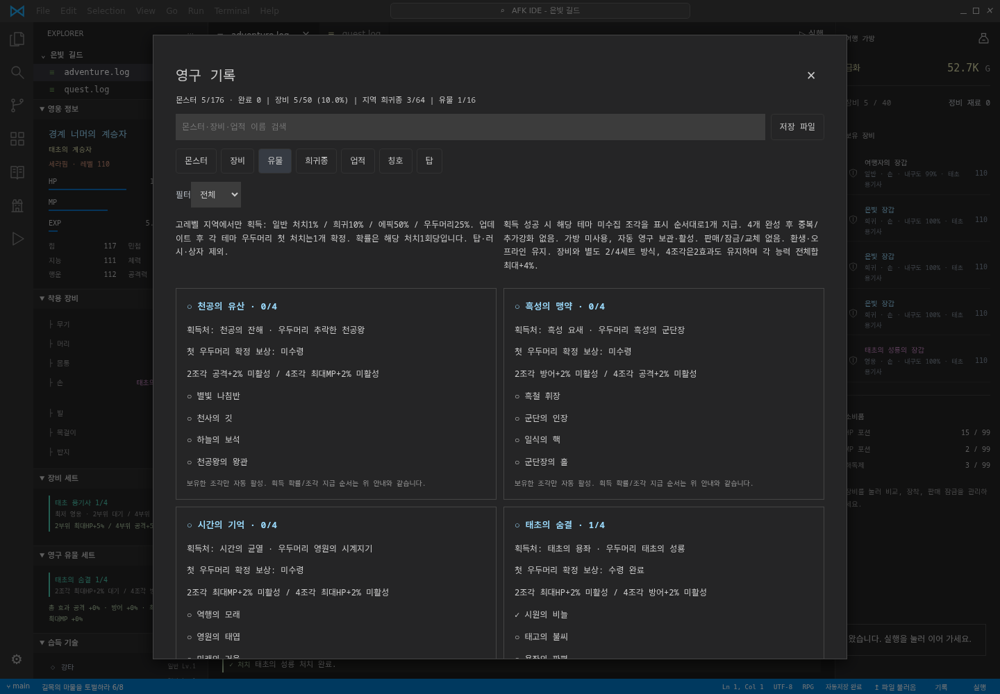
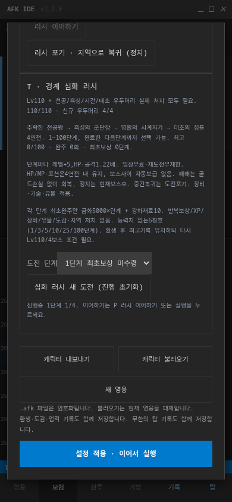

# AFK IDE

**겉은 VSCode, 안은 판타지 자동 모험 RPG.**

[지금 플레이하기](https://sigco3111.github.io/afk-ide/) · [전체 설계·변경 기록](docs/DESIGN.md)

이 프로젝트는 번역판이 아닌 **[원작]** 브라우저 게임입니다. 탐색기, 로그 탭, 통합 터미널, 파란 상태바 속에서 영웅이 사냥하고 장비를 모읍니다. 실행 중에는 자동으로 모험하고, 정지하면 다음 여정을 준비합니다. 설치·회원가입·결제·사운드 없이 PC와 모바일에서 플레이합니다.

현재 완성 버전: **v1.7.0**. 핵심 게임, 저장 호환, 리밸런싱과 엔드콘텐츠까지 마무리했습니다.

## 화면

| 고레벨 모험 | 경계 심화 러시 |
|---|---|
|  |  |

| 영구 유물 도감 | 모바일 |
|---|---|
|  |  |

화면은 검증용 저장으로 촬영했습니다. 모든 영웅이 이 수치나 장비로 시작하지는 않습니다.

## 빠른 시작

1. 영웅 이름과 기본 직업(전사·마법사·도적·궁수)을 고르고 **여정 시작**을 누릅니다.
2. 사냥 → 전리품 → 의뢰 → 마을 판매·수리·회복·보급 → 재출발이 자동 반복됩니다.
3. **정지**는 현재 전투가 끝난 뒤 적용됩니다. 원할 때 설정을 바꾸고 **이어서 실행**하세요.
4. A~G는 기본적으로 게임에 맡깁니다. 직접 관리할 메뉴만 위임을 해제하세요.
5. Q에서 원하는 전직을 미리 예약할 수 있습니다. 전직/환생 자격 달성만으로 자동 모험이 강제로 멈추지는 않습니다.
6. 브라우저에 자동저장합니다. 중요한 시점에는 `.afk` 파일로 내보내 별도 보관하세요.

## 전체 시스템

| 구분 | 내용 |
|---|---|
| 기본 성장 | 레벨·5종 스탯·장비7부위·강화·내구도·포션·의뢰·마을·무작위 사건 |
| 직업 | 기본4직업 → Lv30 1차 → Lv60 2차8갈래 → Lv90 3차16갈래 |
| 기술 | 전체 고유 기술228종, 3차112종 포함. 실제 영웅은 선택한 경로의 기술만 배움. 기술4슬롯·사용조건·표식/지속피해/방어/공격강화 연계 |
| 지역 | 총16테마, 무한 지역 반복. 일반6종·우두머리·희귀3종·에픽1종/테마 |
| 도감 | 몬스터176종, 희귀·에픽64종, 장비 원형10×등급5=50기록, 장비세트16종 |
| 기록 | 업적71종·외형 칭호50종. 도감·업적·칭호·유물은 환생 후 유지 |
| 유물 | 환생 유물5종 + 고레벨 영구 유물4세트16조각 |
| 도전 | 무한의 탑, 기존12종 보스 러시, Lv110 경계 심화 러시100단계 |
| 오프라인 | 실행 중 저장한 영웅만 최대8시간, 온라인 엔진100% 효율, 1분 이상 부재부터 정산 |
| 기술 프리셋 | 최대8개, 지역/탑/러시 자동 연결, 게임 추천 자동 구성 |
| 안전 | 전투 후 정지·원인 표시·가방40칸 보호정지·장비잠금·판매보호·수동설정 보존 |

### 전직과 환생

- 1차: Lv30 이후 시련5회 처치. 2차/3차는 레벨·핵심스탯·영구업적·해당 전직 시련을 모두 충족해야 합니다.
- 3차는 Lv90부터 기술이 열리고 Lv95/100/105/110까지 추가됩니다. 준비가 끝나면 수동 선택하거나 Q 예약으로 자동 전직하세요.
- 환생: 이번 모험 Lv60 + 지역10 우두머리 격파. 반드시 미리보기와 확인을 거칩니다. 자동 환생하지 않습니다.
- 환생은 레벨·골드·장비·지역·전직을 초기화하고 환생유물1등급을 줍니다. 영구 수집·최고기록·칭호는 남습니다. 전직 예약/프리셋 자동 연결은 안전하게 해제됩니다.

### 지역과 고레벨 파밍

앞선12테마는 숲·수렁·사막·겨울·심층·왕도·화산·심연·달빛·해저·폭풍·묘역으로 이어집니다. 고레벨4테마는 다음과 같습니다.

| 테마 | 새 영웅 권장레벨 | 우두머리 | 장비 세트 | 유물 세트 |
|---|---|---|---|---|
| 천공의 잔해 | 91~95 | 추락한 천공왕 | 성운 계승자 | 천공의 유산 |
| 흑성 요새 | 96~100 | 흑성의 군단장 | 흑성 정복자 | 흑성의 맹약 |
| 시간의 균열 | 101~105 | 영원의 시계지기 | 시간 방랑자 | 시간의 기억 |
| 태초의 용좌 | 106~110 | 태초의 성룡 | 태초 용기사 | 태초의 숨결 |

신규 모험은 지역19부터 위 테마가 시작되고 이후4테마를 반복하며 권장레벨이 계속 높아집니다. 이전 저장은 기존 최고 해금 지역 다음(최소19)부터 시작해 이미 열린 지역의 테마·도감ID를 바꾸지 않습니다. S 메뉴에서 이 영웅의 실제 시작 지역을 확인하세요. 입장 자체에 전직 제한은 없고 이전 지역 우두머리를 잡아 순서대로 해금합니다.

신규 우두머리는 전용 이름의 **영웅등급 세트 방어구1개**를 확정 시도합니다. 가방 공간이 없으면 강제로 넣거나 보호장비를 팔지 않습니다.

### 장비·세트·가방

- 일반/고급/희귀/영웅/전설5등급. 동일 테마 방어구 머리·몸통·손·발을 장착하면 2/4부위 효과가 생깁니다.
- 최저 장착등급에 따라2~6%. 4부위는2효과도 유지하며 내구도0 부위는 제외합니다. 2+2 혼합 가능.
- O 가방 정리에서 판매등급·세트보호·더 좋은 장비보호를 설정합니다. 잠근 장비는 팔지 않습니다.
- Q 가방 위임은 기본 켜짐. 40칸이 차면 O 규칙 안에서만 정리합니다. 모두 보호된 경우 안전정지하므로 장시간 진행을 보장하지 않습니다.
- 기본 보호를 끄면 귀중한 장비도 팔릴 수 있습니다. 골드나 진행속도를 위해 보호를 해제할 필요는 없습니다.

### 두 종류의 유물

**환생 유물5종:** 성장의 불씨(XP), 강철 인장(공격), 수호석(HP), 황금 잎(금화), 치유의 잔(마을회복). 정해진 순서로1등급씩, 등급당+2%. 기존 규칙 유지.

**고레벨 유물16조각:** 해당 테마 처치당 일반1% / 희귀10% / 에픽50% / 우두머리25%. 업데이트 후 각 테마 우두머리 첫 처치1개 확정입니다. 과거기록 소급 보상은 없습니다. 성공하면 표시순서대로 미수집 조각1개를 주며 완성 후 중복 강화는 없습니다. 탑·러시·상자에서는 나오지 않습니다.

유물은 가방을 쓰지 않고 자동 영구 활성화합니다. 같은 세트2/4조각마다 서로 다른 능력+2%, 전부 모으면 공격·방어·최대HP·최대MP 각각 합계+4%. 장비/환생 보너스와 곱해집니다. 현재HP/MP를 즉시 회복시키지는 않습니다. 영구 기록 → 유물 탭에 확률·획득처·첫보상·효과가 표시됩니다.

### 탑과 두 러시

- **무한의 탑:** Lv30 해금, 거대한 층수도 과학적 표기로 표시. 전투 후 지역복귀, 실패시 재도전 규칙과 Q 복귀 설정을 지원합니다.
- **보스 러시:** Lv30 + 실제 지역 보스1종. 처치기록이 있는 앞선12테마만 도전. 보스별 최초 금화150×(테마번호+1)/재료2, 반복보상 없음. 기존12완주 배지 유지.
- **경계 심화 러시:** Lv110 + 신규4보스 실제 처치. 4연전, 1~100단계, 최고+1까지 선택. 단계마다 적레벨+5/HP·공격1.22배. 최초완주만5000×단계G/재료10, 1/3/5/10/25/100단계 외형칭호. 높은 단계는 장기 목표이며 즉시 완주를 보장하지 않습니다.

러시에서는 HP/MP·포션이 이어지고 중간 자동보급/수리가 없습니다. 패배시 금화손실 없이 회복하지만 처음부터 재도전합니다. 정지는 현재 보스 후, 지역복귀는 도전포기입니다. 러시는 XP·장비·유물·지역도감을 주지 않습니다. 심화기록과 기존12러시기록은 별도입니다.

### 오프라인·자동 진행·프리셋

- 마지막 실행 저장시각 기준 최대8시간을 같은 전투 엔진으로 계산합니다. 1분 미만, 정지 저장, 시각 역행은 지급하지 않습니다.
- 계산 중에는 입력을 막고, 저장을 마친 뒤 요약을 보여줍니다. 재로드로 같은 시간을 두 번 받지 않습니다.
- 가방보호·목표·수동정지·모드종료 조건이면 남은 시간을 억지로 진행하지 않습니다. 장비와 유물 획득 내역을 따로 표시합니다.
- Q는 전직 예약/가방 위임/목표 후 계속/탑·러시 복귀를 관리합니다. 모두 같은 설정으로 온라인·오프라인에 적용됩니다.
- R은 기술프리셋8개와 지역/탑/러시 연결을 관리합니다. 게임 추천 자동 구성을 쓸 수 있고, 같은 모드 중 수동 선택한 기술을 계속 덮어쓰지 않습니다. 미습득/다른 직업 기술은 안전하게 처리합니다.

## 밸런스와 안전한 저장

v1.6.1은 3차 전직 뒤 지나치게 빠른 성장을 다듬었습니다. Lv30 이후 적HP, Lv60 이후 공격·처치보상을 완만하게 조정했습니다. 1.2초 전투턴과 기본HP14배, 요구경험치 `round(50×Lv^1.6)`는 그대로입니다. 기존 레벨·경험치를 재계산하거나 빼앗지 않습니다. 오프라인은 동일 엔진100%이며 별도 패널티를 주지 않습니다.

`.afk`와 자동저장은 AES-256-GCM/PBKDF2/HMAC 및 범위 검증을 사용합니다. **클라이언트 게임의 손상·임의수정 탐지이지 서버 보안/완전한 부정행위 방지가 아닙니다.** 브라우저 데이터 삭제·기기변경에 대비해 파일을 보관하세요. 오래된 파일을 불러오면 영구기록도 그 시점으로 되돌아갑니다. 자동 클라우드 동기화는 없습니다.

## 개발·검증

소스는 모듈별 JavaScript + `source.html` + `style.css`입니다. 배포는 단일 `index.html`로 묶습니다.

```sh
python3 build.py
npm install
npm test
node tests/relics.test.js
node tests/endgame.test.js
node tests/balance.test.js
```

UI 검증은 Playwright/Chrome을 사용하며 일부 테스트는 엔진 테스트가 만드는 `/tmp` 저장fixture가 필요합니다. 연결된 서비스나 비밀키는 필요하지 않습니다. 개발 중 테스트용 저장을 실제 자동저장에 덮어쓰지 않도록 별도 브라우저를 사용하세요.

검증 범위: 4직업·전직16경로·도감/드랍·세트·유물·러시 실제전투, 암호화 왕복/오류거부, 구저장 import/export, 오프라인 중복방지, 보호가방, PC/390/320px 모바일 및 화면 픽셀 확인. 모든 미래 단계의 모든 장비조합을 완주 검증했다는 뜻은 아닙니다.

## 버전 히스토리

| 버전 | 주요 변경 |
|---|---|
| 1.7.0 | 경계 심화 러시4연전/100단계, 업적71/칭호50, 최종문서 |
| 1.6.1 | 고레벨 성장·적HP/공격·처치보상 리밸런싱, 요구XP/저장유지 |
| 1.6.0 | 고레벨 영구 유물4세트16조각, 획득처/확률/도감/오프라인내역 |
| 1.5.0 | 고레벨4테마/신규44도감/장비세트4개/전용보스방어구 |
| 1.4.2 | 기술프리셋8개, 모드별 자동연결·추천구성 |
| 1.4.1 | 실제엔진 오프라인100%/최대8시간, 저장우선/중복방지 |
| 1.4.0 | 3차전직16경로/신규112기술/Lv90~110 성장 |
| 1.3.x | 기존12보스러시, 영구업적·칭호 확장, 가방/자동진행/정지원인 |
| 1.2.x | 추가지역·희귀/에픽·장비세트·2차전직·기술연계·탑·수집 |
| 1.1.x | 환생·영구유물·도감·업적 |
| 1.0.x | 기본모험·암호화저장·VSCode형UI·다중턴전투 |

상세 규칙과 변경별 기록은 [DESIGN.md](docs/DESIGN.md)에 남겼습니다. 동료·일일의뢰는 이번 완성 범위에 포함하지 않았습니다.
