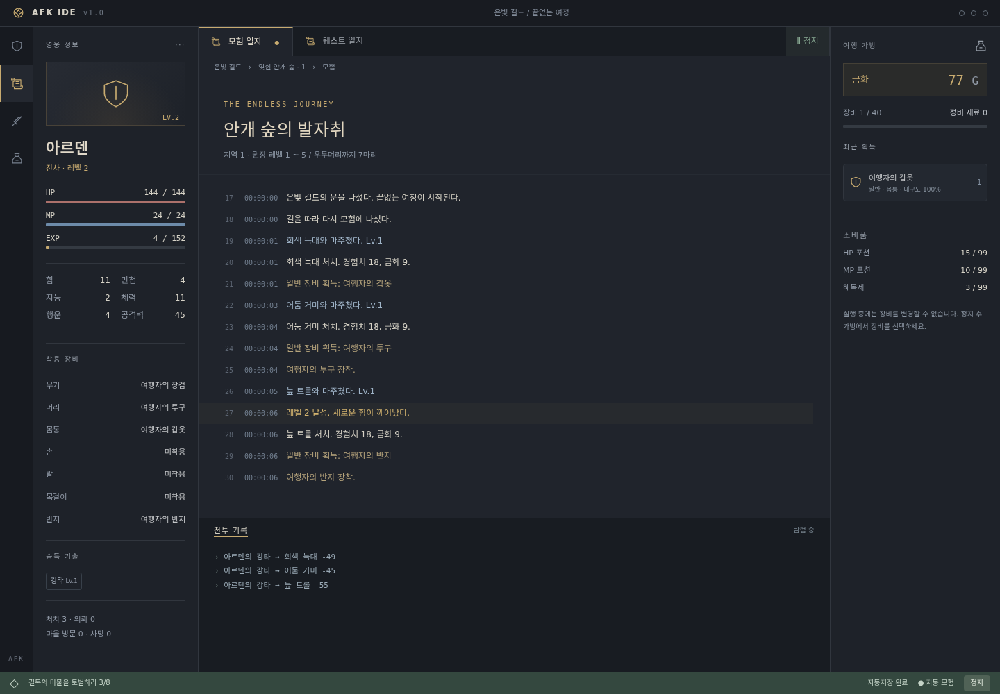
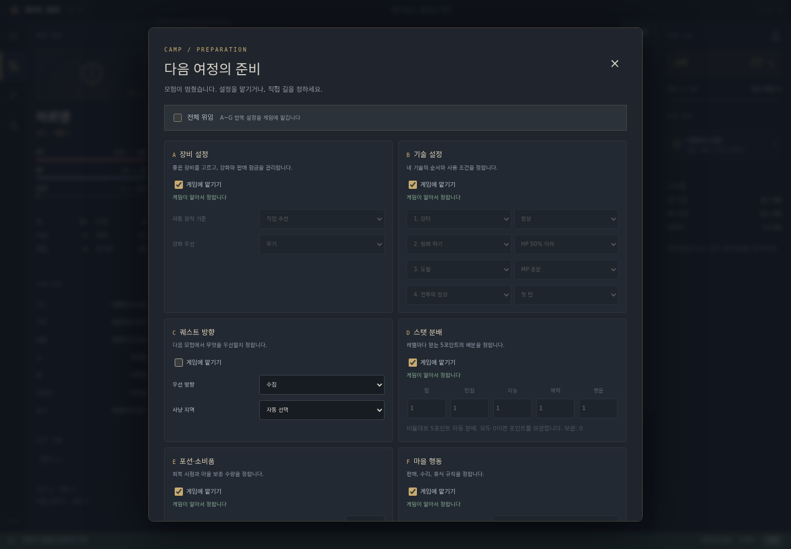
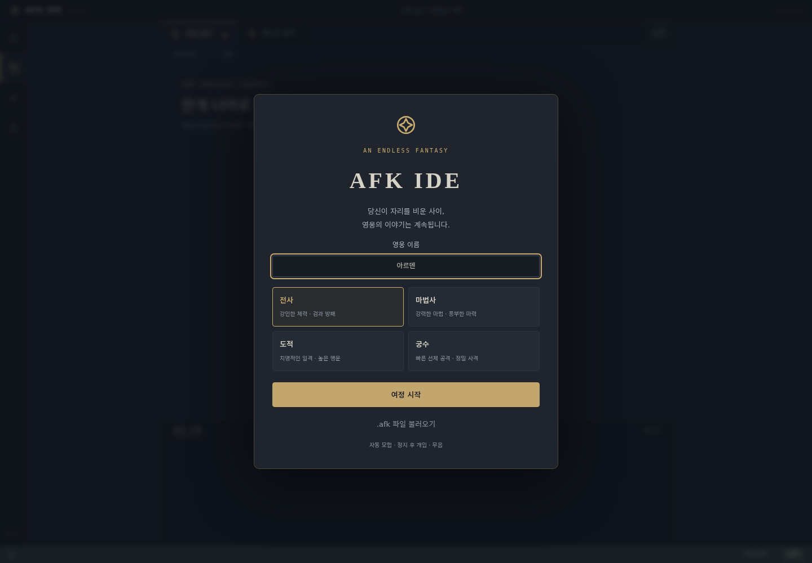
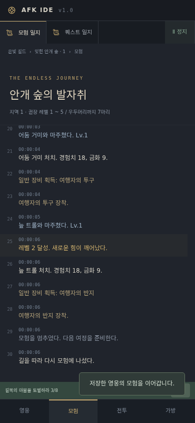

# AFK IDE

### 자리를 비운 동안에도, 영웅의 여정은 계속됩니다.

VSCode 같은 어두운 IDE 화면 속에서 펼쳐지는 **정통 판타지 방치형 RPG**입니다. 화면은 개발 도구처럼 보이지만, 안에 담긴 것은 몬스터, 장비, 기술, 퀘스트입니다. 실행하면 영웅이 스스로 모험하고, 정지하면 다음 여정을 준비할 수 있습니다.

## 플레이

[지금 플레이하기](https://sigco3111.github.io/afk-ide/) · [전체 설계 문서](docs/DESIGN.md) 설치나 계정, 서버가 필요 없습니다. 사운드는 없습니다.

1. 영웅의 이름과 기본 직업을 고르고 **여정 시작**을 누릅니다.
2. 사냥 → 전리품 → 의뢰 완료 → 마을 귀환 → 판매·수리·회복·보급 → 재출발이 자동으로 반복됩니다.
3. **정지**를 누르면 현재 전투가 끝난 뒤 개입 화면이 열립니다.
4. 반복 설정은 기본적으로 모두 게임에 위임되어 있습니다. 직접 관리하고 싶은 메뉴만 위임을 해제하세요.
5. 레벨 30 이후 시련에서 5회 처치하면 정지 화면에서 1차 전직을 선택할 수 있습니다.
6. 브라우저에 자동저장됩니다. 기기를 바꾸거나 데이터를 보관하려면 **캐릭터 내보내기**로 `.afk` 파일을 보관하세요.

> 창이 열려 있는 동안만 진행합니다. 창을 닫은 시간의 오프라인 보상은 없습니다. 백그라운드 탭은 브라우저 정책에 따라 느려질 수 있으며, 돌아오면 열려 있던 시간 범위 안에서 경과 시간을 보정합니다.

## 화면

| 자동 모험 | 정지 후 개입 |
|---|---|
|  |  |

| 시작 화면 | 모바일 모험 |
|---|---|
|  |  |

데스크톱은 영웅 정보, 모험 일지, 전투 기록, 가방, 하단 상태바의 다섯 영역으로 구성됩니다. 휴대폰에서는 **영웅 / 모험 / 전투 / 가방** 탭을 사용합니다. 아이콘은 모두 SVG이며, 외부 이미지나 음원을 내려받지 않습니다.

## v1의 핵심 시스템

### 네 직업과 1차 전직

| 기본 직업 | 1차 전직 | 특징 |
|---|---|---|
| 전사 | 나이트 | 힘과 체력, 높은 생존력 |
| 마법사 | 위저드 | 지능과 마력, 강한 기술 피해 |
| 도적 | 로그 | 민첩과 행운, 치명타·보물·함정 대응 |
| 궁수 | 레인저 | 민첩과 힘, 첫 턴 선제 공격 |

기본 기술은 레벨 1 / 5 / 10 / 20에 해금됩니다. 1차 전직에서 세 기술을 더 얻습니다. 기술은 MP와 재사용 대기 턴을 사용하며, 사용 횟수에 따라 최대 Lv10까지 숙련도가 오릅니다. 네 슬롯의 조건과 순서에 따라 자동으로 기술을 선택합니다.

### 끝없는 모험

- 시드와 지역 번호로 같은 지형을 재현합니다. 숲, 늪, 사막, 설산, 동굴, 폐허, 화산, 심연의 여덟 테마가 이어집니다.
- 테마마다 일반 몬스터 6종과 우두머리 1종이 있습니다. 일반 처치를 쌓으면 우두머리를 만나고 다음 지역이 열립니다.
- 지역 번호가 커질수록 적이 강해집니다. 현재 영웅 레벨과 위험 허용도를 반영해 적 레벨을 조정합니다.
- 토벌, 수집, 탐험, 우두머리 의뢰를 자동 수락하고, 완료 즉시 보상과 다음 의뢰를 받습니다.
- 조우에는 보물상자 4%, 함정 3%, 떠돌이 상인 3%, 희귀 몬스터 2%가 포함됩니다.
- 사망하면 금화 10%를 잃고 부활합니다. 게임 오버나 엔딩은 없습니다.

### 장비와 마을

무기, 머리, 몸통, 손, 발, 목걸이, 반지의 7슬롯. 일반 / 고급 / 희귀 / 영웅 / 전설의 5등급입니다. 장비는 레벨별 위력, 추가 스탯, 내구도와 +10까지의 강화를 가집니다. 강화 실패에도 파괴되지 않습니다. 가방은 장비 40칸이고 소비품은 별도 최대 99개씩 보관합니다.

가방이 90% 이상 차거나 회복 보급이 부족하면 마을로 돌아갑니다. 규칙에 따라 잠기지 않은 장비를 판매하고, 내구도 30% 미만 장비를 수리하고, 휴식·포션 보충·강화를 한 뒤 다시 출발합니다. 잠근 아이템은 자동 판매에서 제외됩니다.

### 정지 후 개입 A~H

| 메뉴 | 직접 정하는 것 |
|---|---|
| A 장비 | 자동 장착 점수 기준, 강화 우선 부위. 가방에서 비교·교체·판매 잠금 |
| B 기술 | 네 슬롯과 항상 / HP 50% 이하 / MP 충분 / 우두머리 / 첫 턴 조건 |
| C 퀘스트 방향 | 사냥 / 퀘스트 / 수집 / 안전, 열린 지역 중 사냥터 선택 |
| D 스탯 | 다섯 능력치 배분 비율, 미분배 포인트 수동 사용 |
| E 소비품 | HP·MP 사용 임계값, 마을 목표 수량, 해독제 규칙 |
| F 마을 | 판매 기준, 수리 여부, 휴식 수준 |
| G 위험 | 1 신중 ~ 5 과감 |
| H 전직 | Lv30 시련 완료 후 1차 전직 직접 선택 |

A~G 위임 체크박스는 독립적이며 기본 켜짐입니다. 위임은 수동 설정을 덮어쓰지 않고 별도의 직업·상황 추천값을 사용합니다. 다시 해제하면 직전 수동값이 복원됩니다. 전직은 전체 위임 대상이 아닙니다.

## 저장과 보안

- **자동저장**: 30초마다, 전투 종료·마을 귀환·정지 등 주요 상태 변경 시 암호화해 `localStorage`에 저장합니다. 슬롯은 하나입니다.
- **내보내기**: 영웅 이름의 `.afk` 파일을 내려받습니다. 정지 상태에서 이용합니다.
- **불러오기**: 파일 크기·헤더·인증·스키마를 검사한 뒤 대체 확인을 받습니다. 취소하면 현재 영웅은 유지됩니다. 불러온 영웅은 정지 상태로 시작합니다.
- **AES-256-GCM**: 매 저장마다 16바이트 무작위 솔트와 12바이트 IV를 새로 만듭니다.
- **키 파생**: PBKDF2 / SHA-256 / 100,000회. AES 키와 HMAC 키는 파생 비트에서 분리합니다.
- **이중 무결성**: 정렬된 JSON 전체의 HMAC-SHA-256과 GCM 인증 태그를 검사합니다.
- **파일 레이아웃**: `AFK1 | 버전 1바이트 | 솔트 16바이트 | IV 12바이트 | 암호문+태그`, 전체 Base64.
- **범위 검사**: 경험치 누적과 현재 레벨의 일치, 스탯·장비·포션·설정·로그의 형식과 범위를 검사합니다.

> 서버 없는 클라이언트 게임입니다. 빌드 안의 키 재료는 코드를 분석하는 사람에게 숨길 수 없습니다. 일반적인 텍스트 편집과 파일 손상은 탐지하지만, 전문적인 조작을 완벽하게 막는 서버 검증은 아닙니다. 브라우저 데이터 삭제·비공개 모드·저장 공간 부족에는 자동저장이 사라질 수 있으므로 중요한 영웅은 파일로 보관하세요.

## 기술 구조

외부 런타임 의존성이 없는 HTML / CSS / ES modules로 구성됩니다. GitHub Pages에는 동일 소스를 합친 `index.html`을 배포하며, 네트워크 없이도 화면·게임·암호화가 돌아갑니다. Web Crypto를 위해 HTTPS 또는 localhost 환경이 필요합니다.

| 파일 | 역할 |
|---|---|
| `data.js` | 직업·지역·아이템 등급·기본 설정 데이터 |
| `engine.js` | 상태, 위임 조회, 전투·성장·전리품·의뢰·마을·지역 생성 |
| `save.js` | 암호화·복호화·무결성·스키마 검사·저장 큐 |
| `ui.js` | 화면, 로그, 개입 메뉴, 파일 입출력, 200ms 루프 |
| `style.css` | IDE 레이아웃, 320px / 390px 모바일 대응, 접근성 |
| `index.html` | 배포용 단일 파일 |
| `source.html` | 모듈을 불러오는 개발용 HTML |
| `build.py` | 모듈 소스에서 배포용 HTML 생성 |
| `docs/DESIGN.md` | 승인된 전체 한국어 설계 문서와 로드맵 |
| `tests/engine.test.js` | 4직업 성장·전직·루프·저장·변조·정지 테스트 |
| `tests/browser.test.js` | 실제 Chrome UI·모바일·저장·위임 테스트 |

전투는 고정 틱 상태 기계로 진행합니다. 렌더링과 전투를 분리하고, 정지 요청은 현재 전투 결과를 확정한 뒤 반영합니다. 로그는 각각 최근 200줄로 제한합니다. 저장 큐는 한 번에 하나씩 암호화하여 오래된 비동기 저장이 새 진행을 덮는 문제를 막습니다. 사용자 이름과 불러온 문장은 HTML로 해석되지 않도록 이스케이프합니다.

### 개발 실행과 테스트

```sh
python3 -m http.server 8080
# 브라우저에서 http://localhost:8080/source.html
npm test
# UI 테스트: Chrome과 playwright 필요
npm install --no-save playwright
node tests/browser.test.js
# 배포용 HTML 재생성
python3 build.py
```

## 검증

- 4직업 × 3회 자동 테스트에서 모두 기본 위임 상태로 Lv30 도달, 시련 완료, 사망 0회.
- 1차 전직 뒤 추가 2,000회 틱을 진행해 Lv71~73 구간, 마을 판매·보급·재출발, 퀘스트와 네 랜덤 이벤트 확인.
- 암호화 저장 왕복 일치, 파일 한 글자 변조 거부, 전투 종료 후 정지, 정지 중 상태 불변 확인.
- 실제 Chrome에서 레벨업, 로그, 정지 화면, 7개 위임 기본값, 위임 해제 후 수동값 복원, 암호화 자동저장·새로고침 복원 확인.
- 320px / 390px 모바일의 네 탭과 설정 화면에서 가로 넘침 없음 확인.

수치와 확률은 첫 버전의 초기 밸런스입니다. 새 직업·새 기능은 기존 저장과의 호환성을 확인한 뒤 확장합니다.

## 이후 계획

- **v1.1**: 환생과 영구 유물, 몬스터 도감·장비 수집첩·희귀종 수집, 업적과 칭호, 2차 전직.
- **v1.2**: 무한의 탑, 탑 최고 기록·배지, 목표 자동 정지, 로그 필터.
- **v1.3**: 3차 전직, 전설 고유 효과와 장기 콘텐츠 확장.

이 기능들은 현재 v1에 구현된 기능이 아닙니다. 자세한 해금 조건, 보존·초기화 규칙, 인수 기준은 [설계 문서](docs/DESIGN.md)를 참고하세요.
